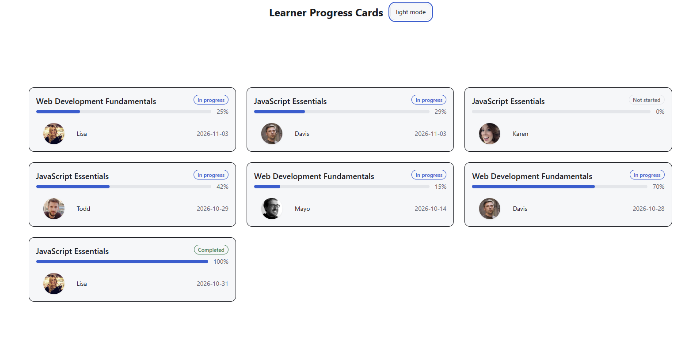
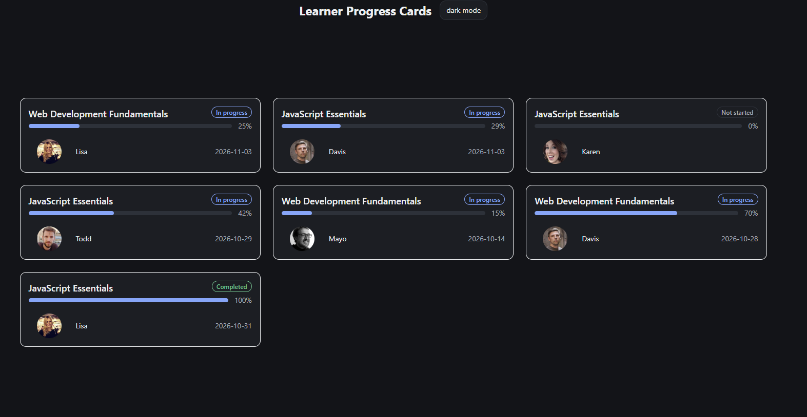
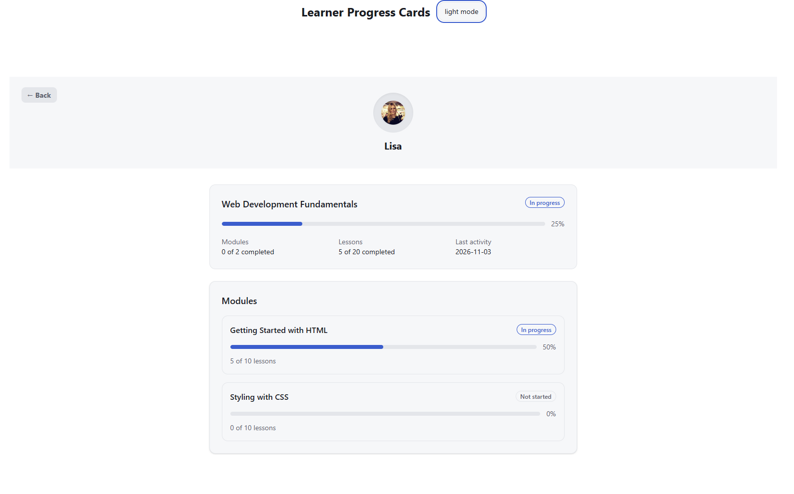
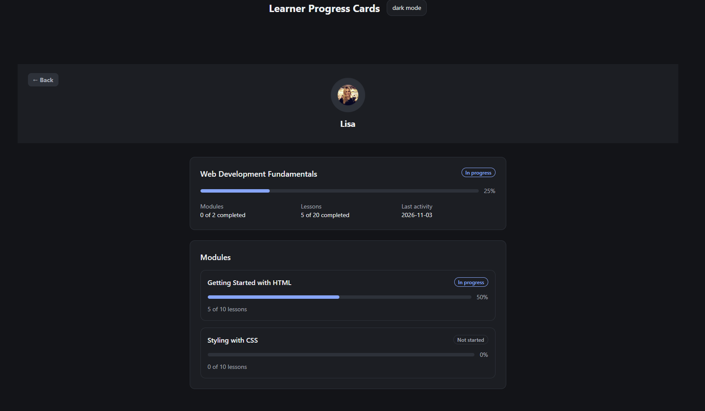

# Learner Progress Card: Pull Request Description

## Summary
Adds the data layer, API and UI for a learner progress card. Postgres (Docker) and Prisma store programs, modules, lessons and completions. An Express API calculates progress on the backend. A React app shows a list of learner cards and a detail page, with light and dark themes from the design tokens.

## What changed

**Database**
- Postgres 18 in Docker (host port 5433), Prisma 7 schema with six models, committed migration.
- Seed: 2 programs, 5 learners, 7 enrolments, 63 completions, fixed dates.

**API**
- `GET /api/learners` and `GET /api/learners/:username?programId=`.
- Progress calculated on the backend. Errors: 400, 404, 500 as JSON.

**Frontend**
- Learner list, learner detail page (summary, modules), loading / error / not-found states.
- Design tokens as CSS variables mapped into Tailwind, light/dark theme with a toggle.

## Decisions and tradeoffs
- Percent is lesson-based; modules completed is a separate figure.
- Last activity is `MAX(completed_at)`, derived, not stored.
- Exercises are not modelled.
- Seed wipes and recreates data so it is repeatable.
- `prisma-client-js` generator so plain Node can `require` the client.
- URLs use `username` + `programId`.

## How to test
See the README for setup. Then open http://localhost:5173 and compare each card with the table in the README.

## Screenshots
Light and dark theme of the list and detail page:

## AI notes
Tools used: [e.g. Claude], for schema review, Prisma 7 setup, API and component review, and PR drafting.
- **Promise array bug.** A draft of `getLearnerProgress` used `map(async ...)` without awaiting, so `modules` held Promises and the module totals broke. I noticed it while reviewing the response shape, and removed the `async`, since nothing inside awaited.
- **TypeScript client.** The AI had me `require` the generated Prisma client, but the `prisma-client` generator emits TypeScript, which plain Node can't load. The module error showed it, and I switched to `prisma-client-js`.
- **Misleading `P1001`.** The AI suggested Docker, port and IPv6 causes. I checked those, then logged the connection string and found it was `undefined` because `.env` wasn't loaded. Adding `dotenv` fixed it.
- **Over-engineering.** Several suggestions were more than the task needed (abort-controller cleanup, a query per module, per-module last activity). I simplified them.
- **Noise in git.** Prisma setup added AI tool folders and a lock file, which made `git status` show 226 changed files. I excluded them in `.gitignore`.

## Known limitations and next steps
- Not built because of the deadline: weekly lessons chart (and `weekly` in the API), learner switcher on the card, automated tests.
- Responsive layout, keyboard use and contrast are not fully verified.
- Exercises are not modelled.
- Seed is wipe-and-recreate, so it is unsafe for a database with real data.
- Avatars load from external URLs; initials would remove that dependency.